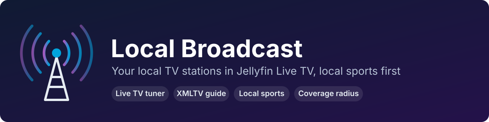
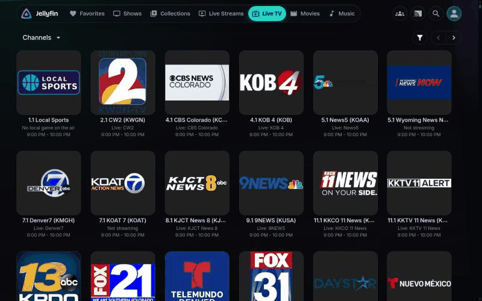
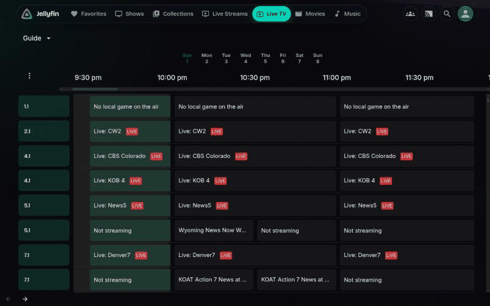
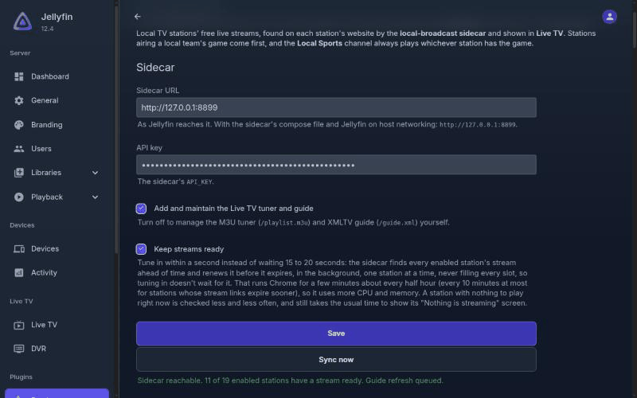
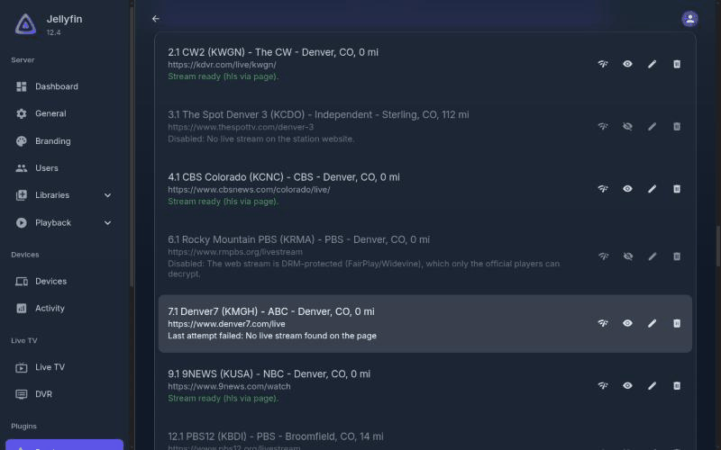

# Local Broadcast for Jellyfin

[](https://github.com/baverrr/media-scraper/actions/workflows/ci.yml)
[](https://github.com/baverrr/media-scraper/releases/latest)
[](LICENSE)

A Jellyfin plugin that adds your local TV stations to Live TV, using the free live streams on the stations' own websites. When one of your teams is on over-the-air TV, a *Local Sports* channel switches to the station airing the game.

<p align="center">
  
</p>

> [!TIP]
> Use **Test now** on any station to see what the sidecar finds on its page, or why it can't play it.

> [!IMPORTANT]
> This is an independent project, not affiliated with or endorsed by Jellyfin, ESPN, any TV network, or any station. It plays only streams that stations publish for free on their own websites. You're responsible for following those sites' terms and your local laws.

**[What it does](#what-it-does)** · **[What you need](#what-you-need)** · **[Install](#install)** · **[How to use it](#how-to-use-it)** · **[Help](#help)**

## What it does

- **Live TV without a tuner.** Stations appear as Live TV channels with a guide. The plugin sets up the tuner and guide itself.
- **Local sports first.** Your teams' games, from ESPN's schedules, put the station airing them at the top, and the *Local Sports* channel plays the game.
- **Coverage area.** Keep only stations within a set number of miles of you or the market's center.
- **Streams that keep working.** Station stream links expire within minutes or hours. The sidecar finds fresh ones behind links that don't change.
- **Fast for Anvato stations.** Stations whose player is Anvato (Nexstar's FOX and CW stations, among others) get a fresh stream in under half a second, without opening a browser, after the first visit to their page.
- **Test now.** See what the sidecar finds on a station's page, or why it can't play it.
- **Stays on your server.** No telemetry and no accounts. See [PRIVACY.md](PRIVACY.md).

<table>
  <tr>
    <td></td>
    <td></td>
  </tr>
  <tr>
    <td align="center">Stations as Live TV channels</td>
    <td align="center">The guide</td>
  </tr>
  <tr>
    <td></td>
    <td></td>
  </tr>
  <tr>
    <td align="center">Connecting the sidecar</td>
    <td align="center">Stations and why each one plays or not</td>
  </tr>
</table>

The plugin needs a small companion Docker container, the *sidecar*. It opens each station's live page in headless Chrome and finds the stream with [`media-scraper.js`](docs/media-scraper.md), a browser script in this repo that also works on its own.

## What you need

- Jellyfin 12.2
- Docker (Docker Desktop on Windows and macOS), on an x86-64 or ARM64 machine (Raspberry Pi 4/5 works)

## Install

1. Download the project:

   ```bash
   git clone https://github.com/baverrr/media-scraper.git
   cd media-scraper
   ```

2. Make the sidecar's keys and start it. It listens on `127.0.0.1:8899`:

   ```bash
   echo "LOCAL_BROADCAST_API_KEY=$(openssl rand -hex 24)" > sidecar/.env
   echo "LOCAL_BROADCAST_LOGIN_KEY=$(openssl rand -base64 32)" >> sidecar/.env
   chmod 600 sidecar/.env
   docker compose -f sidecar/compose.yaml up -d
   ```

   These commands work on Linux and macOS. For Windows, see **Windows and Docker networking** below.

3. In Jellyfin, go to **Dashboard > Plugins > Repositories** and add:

   ```
   https://baverrr.github.io/media-scraper/manifest.json
   ```

4. Install **Local Broadcast** from the catalog and restart Jellyfin.

<details>
<summary><b>Windows and Docker networking</b></summary>

On Windows, run this in PowerShell from the repository folder, then open `sidecar/.env` in Notepad to copy the API key:

```powershell
$rng = [Security.Cryptography.RandomNumberGenerator]::Create()
$api = [byte[]]::new(24); $rng.GetBytes($api)
$login = [byte[]]::new(32); $rng.GetBytes($login)
Set-Content -Path sidecar/.env -Encoding ascii -Value @(
  "LOCAL_BROADCAST_API_KEY=$(-join ($api | ForEach-Object { $_.ToString('x2') }))",
  "LOCAL_BROADCAST_LOGIN_KEY=$([Convert]::ToBase64String($login))"
)
docker compose -f sidecar/compose.yaml up -d
```

- Jellyfin installed directly on the computer, or using host networking: the sidecar URL is `http://127.0.0.1:8899`.
- Jellyfin in a bridge-network container, or in Docker Desktop: put both containers on one Docker network and use `http://local-broadcast:8899`.
- The sidecar doesn't need to be reachable from anywhere else. Jellyfin re-serves the streams to your apps.
- To start with a different bundled market, add `MARKET=<market>` to `sidecar/.env`, using a file name from [`sidecar/markets/`](sidecar/markets/).
- On ARM, the image uses Playwright's Chromium, because Google Chrome isn't built for ARM Linux.
</details>

## How to use it

1. **Connect.** In **Dashboard > Plugins > Local Broadcast**, set the sidecar URL and API key, pick your market, and save. Channels appear in Live TV after the guide refresh it starts.
2. **Add your teams.** Each bundled market comes with its area's teams. While a game is on (from 15 minutes before), *Local Sports* (channel 1.1 by default) plays it, that station moves to the top, and the game shows in Jellyfin's Sports row.
3. **Set a coverage area.** Under **Coverage area**, set a maximum distance in miles (0 means no limit) and your location, then press **Save coverage area**.
4. **Test a station.** Press **Test now** to see why a station won't play: offline, DRM, bot check, no live stream, and so on.

Between games, *Local Sports* plays a "No local game on the air" card. Stations' web streams often show their own news instead of network games, because networks and leagues rarely allow games on station websites.

<details>
<summary><b>Which stations work</b></summary>

| The station's website... | Result |
| --- | --- |
| plays an HLS stream in its own web player | Works. Most stations. |
| plays an Anvato (Lura) stream, as Nexstar's stations do | Works, and after the first visit without opening a browser |
| streams through Google's ad-insertion service (DAI) | Works, also behind DNS ad blockers such as AdGuard or Pi-hole |
| embeds YouTube or another site yt-dlp supports | Works through yt-dlp |
| streams only during newscasts | Plays during newscasts, shows "Nothing is streaming right now" otherwise |
| streams only to signed-in (free) accounts | Works with a sign-in saved for the station, when the sign-in form is a plain one |
| uses DRM or streams only in an app | Doesn't work |
| shows a bot check | Doesn't work while the check is up. The sidecar never solves one, but makes them rarer: it comes back as the same visitor, and leaves a site alone for a while (15 minutes, doubling up to 6 hours) after one |
| plays another station's stream | Left off, so the same channel doesn't appear twice |

Stations that don't work stay in the market file, turned off, with a note saying why. To turn one on, paste a stream URL you're allowed to use: a `.m3u8` that doesn't expire, or a page yt-dlp supports.
</details>

<details>
<summary><b>Markets, coverage area and station sign-ins</b></summary>

- **Markets** are JSON files in [`sidecar/markets/`](sidecar/markets/) with a center, time zone, stations and local teams. Under **Market defaults** you can load one or more markets, save your edited list as your own market, import, export, hide or delete them.
- **Coverage area:** press **Use this device's location** to fill in your location (browsers share it only over HTTPS or from localhost). Leave it empty to measure from the market's center. Stations you add yourself are always included unless you give them a latitude and longitude. [Picture of how it works](docs/images/coverage.svg).
- **Station sign-ins:** edit a station to save an email and password, or have the sidecar fill in the site's sign-up form for you. It stops at CAPTCHAs, emailed codes or extra questions. Sign-ins are encrypted (AES-256-GCM) in the sidecar's data volume and never shown again, so keep them in your password manager.
</details>

## Help

**No channels in Live TV.** Check the sidecar URL and API key in the plugin settings, and that the sidecar is running: `docker compose -f sidecar/compose.yaml ps`.

**A station shows "Nothing is streaming right now".** It streams only during newscasts. Try again then.

**A game started while I was on the "No local game" card.** Tune in to *Local Sports* again.

**My area isn't included.** [CONTRIBUTING.md](CONTRIBUTING.md) shows the market file format and how to test it. Pull requests are welcome.

<details>
<summary><b>For developers</b></summary>

- Sidecar settings: `API_KEY`, `MARKET`, `TZ`, `MAX_HEIGHT` (default `1080`), `LOGIN_KEY`, `RESOLVE_TTL_MINUTES` (default `30`), `MAX_CONCURRENT_RESOLVES` (default `2`), `BROWSER_CHANNEL` (default `chrome`, empty for the bundled Chromium), `REMEMBER_VISITS` (default `true`: keep each station's cookies between visits), `ANVATO_FAST_PATH` (default `true`) and `PUBLIC_URL`. See [`sidecar/compose.yaml`](sidecar/compose.yaml).
- Sidecar API: `GET /playlist.m3u`, `/guide.xml`, `/stream/<id>.m3u8`, `/api/status`, `/api/sports`, `/api/stations`. With the `X-Api-Key` header: `PUT /api/stations`, `PUT /api/sports`, `POST /api/stations/<id>/test`. Proxied segment URLs are HMAC-signed.
- Run the tests:

  ```bash
  (cd sidecar && npm ci && npx playwright install chromium && npm test)
  docker run --rm -v "$PWD":/src -w /src mcr.microsoft.com/dotnet/sdk:10.0 dotnet test Jellyfin.Plugin.LocalBroadcast.Tests
  docker build -f sidecar/Dockerfile -t local-broadcast-sidecar .
  ```

- How the parts fit together: [architecture diagram](docs/diagrams/architecture.svg), drawn with archgram from [`docs/diagrams/`](docs/diagrams/).
- Layout: `Jellyfin.Plugin.LocalBroadcast/` (the plugin), `sidecar/` (the Docker sidecar), `media-scraper.js` ([its docs](docs/media-scraper.md)).
- CI runs both test suites and publishes the sidecar image to `ghcr.io/<owner>/local-broadcast-sidecar`. A `vX.Y.Z` tag matching `build.yaml` also publishes a release and the plugin catalog. `scripts/publish-repo.sh <dir>` publishes to your own plugin repository folder instead. CodeQL scans the code weekly.
- Security: see [SECURITY.md](SECURITY.md).
</details>

## License

GPL v3 or later. See [LICENSE](LICENSE), plus the [Privacy](PRIVACY.md) and [Security](SECURITY.md) pages.

Station names, call signs, network names and logos belong to their owners.
