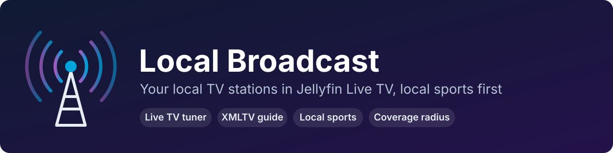
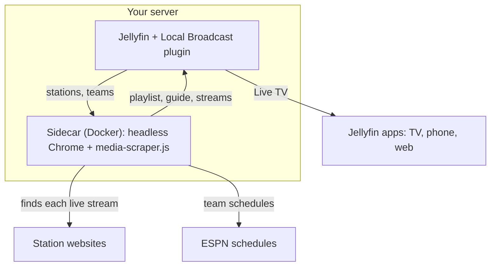
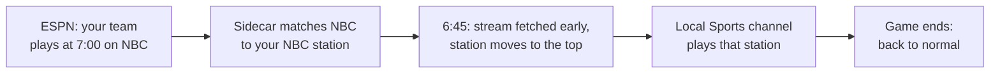
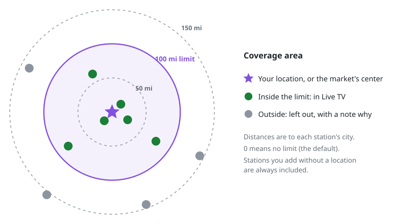

<p align="center">
  
</p>

<p align="center">
  <a href="https://github.com/baverrr/media-scraper/actions/workflows/ci.yml"></a>
  <a href="https://github.com/baverrr/media-scraper/releases/latest"></a>
  
  
</p>

# Local Broadcast for Jellyfin

**Local Broadcast is a Jellyfin plugin** that adds your local TV stations to Jellyfin's Live TV. It uses the free live streams on the stations' own websites. Its headline feature is **local sports**: when one of your teams is on over-the-air TV, a *Local Sports* channel switches to the station airing the game, and the game shows in the guide.

It works with Jellyfin 12.2 and needs a small companion Docker container, the *sidecar*. This repository also contains **[media-scraper.js](#media-scraperjs)**, the browser script the plugin is built on, which works on its own.

**Contents:** [Features](#features) · [How it works](#how-it-works) · [Local sports](#local-sports-first) · [Coverage area](#coverage-area) · [Install](#install) · [Station support](#station-support) · [Markets](#markets) · [Configuration](#sidecar-configuration) · [Privacy and security](#privacy-and-security) · [media-scraper.js](#media-scraperjs)

## Features

- 📺 **Live TV without a tuner.** Stations appear as Jellyfin Live TV channels with an XMLTV guide. The plugin sets up the tuner and guide itself.
- 🏈 **Local sports first.** Your teams' games, from ESPN's schedules, put the station airing them at the top, and a *Local Sports* channel always plays the game.
- 📍 **Coverage area.** Pick how far away stations can be, in miles, from your location or the market's center.
- 🔄 **Streams that keep working.** Station stream URLs expire within minutes or hours. The sidecar finds fresh ones behind stable channel URLs, with no interruption.
- 🧪 **Test now.** See exactly what the sidecar finds on a station's page, or why it can't play it.
- 🛡️ **Private by design.** No telemetry and no accounts; everything runs on your server. See [PRIVACY.md](PRIVACY.md).

## How it works

Many local TV stations stream live for free on their websites, but their players need a real browser, and the stream URLs carry tokens that expire. The sidecar handles both:



| Part | What it does |
| --- | --- |
| **Jellyfin plugin** (`Jellyfin.Plugin.LocalBroadcast/`) | A settings page for stations, local teams and the coverage area. It sends them to the sidecar and adds the sidecar to Live TV as an M3U tuner with an XMLTV guide, so there's nothing to set up under Live TV yourself. |
| **Sidecar** (`sidecar/`, Docker image) | Opens each station's live page in headless Chrome with `media-scraper.js` loaded first, and finds the live HLS stream. Serves it to Jellyfin through a small proxy that re-resolves expired tokens behind stable URLs. Also serves the M3U playlist and the XMLTV guide. |

### Local sports first

Give the plugin your local teams (each bundled market comes with its area's teams). The sidecar reads each team's schedule and TV listings from ESPN's public API. It matches over-the-air broadcasts to your stations by network (a CBS game is on the CBS affiliate), call sign, name, or the station's *sports aliases*.



While a game is on (from 15 minutes before the start):

- the **Local Sports** channel (1.1 by default) plays whichever station is airing the game;
- that station moves to the top of the channel list, and its stream is fetched shortly before the start so tuning in is instant;
- the guide shows the game in the *Sports* category, so it appears in Jellyfin's Sports row, on that station and on Local Sports.

Between games, Local Sports plays a "No local game on the air" card instead of failing. To watch a game that starts while
you're on that card, tune in again.

An honest caveat: stations' web streams often show their own news instead of network games, because networks and leagues rarely allow games on station websites. The guide description says so.

### Coverage area

<p align="center">
  
</p>

To keep only stations near you, open **Coverage area** in the plugin settings:

1. Set a **maximum distance** in miles. 0 means no limit, which is the default.
2. Set **your location**: type a latitude and longitude, or press **Use this device's location**. Browsers share a location only with pages served over HTTPS or from localhost. Leave it empty to measure from the market's center.
3. Press **Save coverage area**.

Enabled stations farther away than the limit stay out of Live TV and Local Sports. The station list shows each station's city and distance, and the status line says how many stations are in range. Stations you add yourself are always included, unless you give them a latitude and longitude. Your location stays in Jellyfin's settings; see [PRIVACY.md](PRIVACY.md).

## Install

1. **Run the sidecar** next to Jellyfin:

   ```bash
   echo "LOCAL_BROADCAST_API_KEY=$(openssl rand -hex 24)" > sidecar/.env
   echo "LOCAL_BROADCAST_LOGIN_KEY=$(openssl rand -base64 32)" >> sidecar/.env
   chmod 600 sidecar/.env
   docker compose -f sidecar/compose.yaml up -d
   ```

   **On Windows**, with [Docker Desktop](https://docs.docker.com/desktop/), run this in PowerShell from the repository folder instead:

   ```powershell
   $rng = [Security.Cryptography.RandomNumberGenerator]::Create()
   $api = [byte[]]::new(24); $rng.GetBytes($api)
   $login = [byte[]]::new(32); $rng.GetBytes($login)
   Set-Content -Path sidecar/.env -Encoding ascii -Value @(
     "LOCAL_BROADCAST_API_KEY=$(-join ($api | ForEach-Object { $_.ToString('x2') }))",
     "LOCAL_BROADCAST_LOGIN_KEY=$([Convert]::ToBase64String($login))"
   )
   docker compose -f sidecar/compose.yaml up -d
   ```

   Then open `sidecar/.env` in Notepad to copy the API key into the plugin. **On macOS**, the commands above for Linux work as they are, with Docker Desktop. On both, Docker Desktop publishes the sidecar on `127.0.0.1:8899` of your computer, so Jellyfin installed directly on the computer uses `http://127.0.0.1:8899`. Jellyfin running in Docker Desktop too uses a shared Docker network and `http://local-broadcast:8899`, since host networking isn't the same there.

   To start with a different bundled market, add `MARKET=<market>` to `sidecar/.env`, using a file name from [`sidecar/markets/`](sidecar/markets/). The browser uses that market's time zone unless you set `TZ`.

   The sidecar listens on `127.0.0.1:8899`. Jellyfin re-serves the streams to your apps, so the sidecar doesn't need to be reachable from anywhere else. If Jellyfin runs in a bridge-network container instead of host networking, put both on one Docker network and use `http://local-broadcast:8899`.

   The image runs on x86-64 and ARM64 (Raspberry Pi 4/5, ARM servers). On ARM it uses Playwright's Chromium, because Google Chrome isn't built for ARM Linux. That Chromium plays H.264/AAC like Chrome does; with it, every enabled bundled station resolved in testing (on x86-64).

2. **Install the plugin.** In Jellyfin, go to Dashboard > Plugins > Repositories and add:

   ```
   https://baverrr.github.io/media-scraper/manifest.json
   ```

   Then install **Local Broadcast** from the catalog and restart Jellyfin.

3. **Configure it.** In Dashboard > Plugins > Local Broadcast, set the sidecar URL and API key, pick your market, and save. The plugin adds the *Local Broadcast* tuner and guide, and the channels appear in Live TV after the guide refresh it starts.

Use **Test now** on a station to see what the sidecar finds, or why not: offline, DRM, bot check, no live stream, an embedded YouTube player, and so on.

## Station support

Whether a station works depends on how its website streams:

| The station's website... | Result |
| --- | --- |
| plays an HLS stream in its own web player | ✅ Works. Most stations. |
| streams through Google's ad-insertion service (DAI), common on Gray Television sites | ✅ Works, also behind DNS ad blockers such as AdGuard or Pi-hole: the sidecar uses `dai.google.com`, which they don't block. |
| embeds YouTube or another site yt-dlp supports | ✅ Works through yt-dlp. |
| streams only during newscasts | ⚠️ Plays during newscasts; at other times the channel shows a "Nothing is streaming right now" screen. |
| uses DRM (Widevine, FairPlay) | ❌ Jellyfin can't play DRM streams. |
| streams only to signed-in (free) accounts | ⚠️ Works with a sign-in saved for the station, when the site's sign-in form is a plain one. See [Station sign-ins](#station-sign-ins). |
| streams only in an app | ❌ No web stream to find. |
| shows a bot check | ❌ The sidecar doesn't get around bot checks, but it [makes them less likely](#bot-checks). |
| plays another station's stream | Left off, so the same channel doesn't appear twice. |

Each market file keeps the stations that don't work, turned off, with a note saying why; the settings page shows the note. To turn one on, paste a **stream URL** you're allowed to use into its settings: a `.m3u8` that doesn't expire, or a page yt-dlp supports, such as the station's YouTube live stream.

### Bot checks

Some station sites put a bot check ("press and hold", "verify you are human", a CAPTCHA) in front of their pages. The sidecar never solves a bot check or tries to get past one: the station fails with *bot check* until the site stops showing it. It does avoid the two habits that make a headless browser get them more often:

- **It comes back as the same visitor.** For a station without a sign-in, the cookies and site storage its page ends with are kept for the next visit, so that visit isn't a first one, which is what bot checks target most. A page that answered with a bot check drops them. Stations with a [sign-in](#station-sign-ins) use their signed-in session instead. Visits unused for a month, and those of stations you remove, are deleted. `REMEMBER_VISITS=false` turns this off and deletes the visits kept.
- **It leaves a site alone after a bot check**, instead of reloading the page every time a player retries: 15 minutes at first, doubling with each bot check in a row up to 6 hours, for every station on that site, signed-in ones too. Meanwhile the channel shows the "Nothing is streaming right now" screen, and **Test now** and the sidecar's log say how long is left. **Test now** tries the station once straight away, and a page that loads ends the wait.

## Markets

A market is a JSON file in [`sidecar/markets/`](sidecar/markets/) with its center, time zone, stations and local teams. The plugin bundles every market file at build time. In the settings, under **Market defaults**:

- **Tick one or more markets** and choose **Load the ticked markets' stations and teams** to reset your list to them. A station in more than one market appears once. The main market (the first one ticked, or the one you star) sets the coverage center and the time zone for newscast times.
- **Save current stations and teams as a market** keeps your edited list as a market of your own, to load again later.
- **Import a market file** adds one in the same format, for example one exported from another server.
- **Export** downloads any market's file. **Delete** removes one of your own; bundled markets can be hidden, and shown again.

Your own markets are kept in the plugin's settings.

Stations in one market file can come from several neighboring TV markets. The market's own stations come first, because a local game goes to the first station carrying its network. Channel numbers are the stations' own, so a few can repeat.

Missing your area? [CONTRIBUTING.md](CONTRIBUTING.md) shows the format and how to test it. Pull requests are welcome.

## Sidecar configuration

| Variable | Default | |
| --- | --- | --- |
| `API_KEY` | none | Required for changes from the plugin (`X-Api-Key`). The compose file reads it from `LOCAL_BROADCAST_API_KEY` in `sidecar/.env`. |
| `MARKET` | set in `compose.yaml` | Stations and teams used until the plugin sends its own. |
| `TZ` | the market's | Time zone the station pages see, and the guide's newscast times (e.g. `America/Chicago`). Set, it overrides the plugin's main market. |
| `MAX_HEIGHT` | `1080` | Highest quality picked from a station's variants. |
| `LOGIN_KEY` | generated | Encrypts saved station sign-ins (32 bytes: `openssl rand -base64 32`). The compose file reads it from `LOCAL_BROADCAST_LOGIN_KEY`. Unset, a key is generated in the data volume as `login.key`. |
| `RESOLVE_TTL_MINUTES` | `30` | How long a found stream is reused (shorter when its token expires sooner). |
| `MAX_CONCURRENT_RESOLVES` | `2` | Browser pages at once; local-sports stations jump the queue, and the background warm-up ("Keep streams ready") never takes the last one. |
| `REMEMBER_VISITS` | `true` | Keep the cookies of stations without a sign-in between visits, which makes [bot checks](#bot-checks) less likely. `false` makes each of their visits a first one, and deletes the visits kept. |
| `BROWSER_CHANNEL` | `chrome` | Google Chrome; empty uses the bundled Chromium (what ARM uses). Both play H.264/AAC. |
| `PUBLIC_URL` | from the request | Base URL written into the M3U. |

HTTP API: `GET /playlist.m3u`, `GET /guide.xml`, `GET /stream/<id>.m3u8` (`local-sports` included), `GET /api/status`, `GET /api/sports`, `GET /api/stations`. With the API key: `PUT /api/stations`, `PUT /api/sports`, `POST /api/stations/<id>/test`. Proxied segment URLs are HMAC-signed, so the proxy can't be used to fetch arbitrary URLs.

## Station sign-ins

Some stations stream only to visitors signed in to a free account on their site. Edit the station in the plugin settings to give it a sign-in:

- **You already have an account:** enter its email and password and choose **Save sign-in**.
- **You don't:** enter the email and password you want, read the site's terms, tick the box, and choose **Create the account for me**. The sidecar fills in the site's own sign-up form. If the site sends a confirmation email, open it yourself.
- **Save the email and password in your password manager.** The sidecar never shows the password again.

The sidecar signs in through the site's own form when the station is played or tested, and keeps the session so it doesn't sign in every time. It stops and says so when a site shows a CAPTCHA, asks for anything beyond an email and password, or signs in with an emailed code. Those accounts are yours to create and use on the site itself.

Sign-ins are encrypted (AES-256-GCM) in the sidecar's data volume. Jellyfin never stores them, and the sidecar's API reports only a station's email and whether the last sign-in worked. Set `LOGIN_KEY` to keep the key out of the data volume.

## Development

```bash
(cd sidecar && npm ci && npx playwright install chromium && npm test)
docker run --rm -v "$PWD":/src -w /src mcr.microsoft.com/dotnet/sdk:10.0 dotnet test Jellyfin.Plugin.LocalBroadcast.Tests
docker build -f sidecar/Dockerfile -t local-broadcast-sidecar .
```

The sidecar tests run `media-scraper.js` and the resolver in a real browser (`sidecar/test/scraper.test.js`, the sign-in tests, and the resolver test in `visits.test.js`). `scraper.test.js` and `visits.test.js` skip theirs when Playwright has no browser installed.

CI (`.github/workflows/ci.yml`) runs both test suites on every push and pull request, and publishes the sidecar image to `ghcr.io/<owner>/local-broadcast-sidecar` (`:edge` from main). On a `vX.Y.Z` tag that matches `version` in `build.yaml`, it publishes the image (`:X.Y.Z`, `:latest`), a GitHub release with the plugin zip, and the plugin catalog on GitHub Pages. `scripts/publish-repo.sh <dir>` publishes to a self-hosted plugin repository folder instead.

## Privacy and security

- **[PRIVACY.md](PRIVACY.md):** what's stored (only on your server) and which sites the sidecar contacts. No telemetry, no accounts.
- **[SECURITY.md](SECURITY.md):** how to report a vulnerability privately, and how to run the sidecar safely.

## Disclaimer

Local Broadcast is an independent project. It isn't affiliated with or endorsed by Jellyfin, ESPN, any TV network, or any station or station group. Station names, call signs, network names and logos belong to their owners. The plugin plays only streams that stations publish for free on their own websites. You're responsible for using it in line with those websites' terms and the laws where you live.

## media-scraper.js

A single, dependency-free browser script that finds media players and streams on any web page and tells you which ones are live.

### Usage

#### DevTools console / bookmarklet / userscript

Paste `media-scraper.js` into the console (or load it as a bookmarklet or userscript), then:

```js
await MediaScraper.scan()                     // prints a table, returns results (live first)
await MediaScraper.scan({ liveOnly: true })   // only live items
await MediaScraper.scan({ probe: false })     // don't fetch manifests to check live status
MediaScraper.watch(item => console.log(item)) // report new streams as the page requests them
MediaScraper.unwatch()
MediaScraper.copy()                           // copy last results as JSON
MediaScraper.results                          // last results
```

#### Puppeteer / Playwright

```js
await page.addScriptTag({ path: 'media-scraper.js' });
const results = await page.evaluate(() => MediaScraper.scan().then(MediaScraper.toJSON));
```

`toJSON` strips the DOM node references so the results serialize cleanly.

#### Loading early (recommended for MSE players)

To pair hls.js, dash.js and Shaka players with their manifests, the script has to run before the page creates them. Load it before the page's own scripts:

- **Userscript:** `// @run-at document-start`
- **Puppeteer:** `await page.evaluateOnNewDocument(fs.readFileSync('media-scraper.js', 'utf8'))`
- **Playwright:** `await page.addInitScript({ path: 'media-scraper.js' })`

Loaded this way, it hooks each library the moment the library assigns itself to `window`.

### What it detects

| Source | Details |
| --- | --- |
| `<video>` / `<audio>` | Including shadow DOM (closed roots too, when [loaded early](#loading-early-recommended-for-mse-players)) and same-origin iframes. Live when `duration === Infinity` or the seekable range extends past the duration. Players fed a MediaStream (`srcObject`: WebRTC, camera, canvas capture) are reported as `mediastream` and always live. |
| Stream URLs | HLS (`.m3u8`), DASH (`.mpd`), Smooth Streaming, FLV, HDS, RTMP, RTSP, SRT, media WebSockets — from network requests, `<source>` tags, attributes, inline scripts and JSON (handles `\/` and `\uXXXX` escaping, and relative paths such as `"/live/index.m3u8"`). WebSockets in scripts are kept only when they look like media (`.flv`/`.ts`/`.mp4`, or `/live/`, `/stream/`, `/media/` paths). |
| Embeds | YouTube, Twitch, Kick, Vimeo, Facebook, Dailymotion, Rumble, Streamable, Wistia, Brightcove, JW Player, Mux, Livestream, IBM Video, Restream, Owncast — with the video/channel ID. Lazy-loaded iframes are read from `data-src`. |
| Player libraries | video.js, JW Player, Plyr, Flowplayer, hls.js, dash.js, Shaka Player, Clappr — in the page and in same-origin iframes. |

Smooth Streaming URLs (`.ism/Manifest`) are typed `smooth`, or `hls` / `dash` for Azure Media Services' `Manifest(format=m3u8-aapl)` / `(format=mpd-…)`.

Results are deduplicated by URL (players without a URL, such as WebRTC, by element); each item lists every method that found it in `foundBy`. HLS variant playlists are folded into their master playlist (listed in its `variants`) rather than reported separately.

Before comparing URLs, parameters that change on every request are dropped: low-latency HLS directives (`_HLS_msn`, `_HLS_part`, …) and cache-busters (`_`, `t`, `ts`, `cb`, `rnd`, …) when their value is a timestamp or random number. A playlist polled once a second is one result, not hundreds. Other parameters, such as signed tokens, are kept exactly as they were.

#### Network capture

As soon as the script loads, it starts a `PerformanceObserver` that records stream requests. Browsers keep only 250 entries in the resource timing buffer, and a live page re-fetches its playlist every few seconds, so `performance.getEntries()` alone stops showing new manifests quickly; the observer keeps receiving them. It keeps the 500 most recently active streams. Same-origin iframes are observed from the first scan that finds them. In Chrome 129 and later, which report each response's content type in resource timing, manifests whose URL has no extension (`/api/stream/123`) are recognised here too.

#### Pairing players with manifests

MSE players (hls.js, dash.js, Shaka) play a `blob:` URL, so the `<video>` itself doesn't say what it's playing. The script hooks `Hls.prototype`, `shaka.Player.prototype` and the `dashjs.MediaPlayer` factory to capture instances created or loaded from then on. If the libraries don't exist yet because the script was [loaded early](#loading-early-recommended-for-mse-players), it hooks each one as soon as it's assigned to `window`. Each MSE element is then linked to its own instance's manifest (`manifest`, `library`) and inherits its live status.

Without a captured instance, the script only guesses when it's unambiguous — one unpaired MSE element and one live manifest, or with `probe: false`, one manifest not known to be VOD — and marks the guess with `manifestGuessed: true`.

Loading the script a second time (a pasted copy on top of a userscript, say) keeps what the first copy's hooks captured.

#### Live probing

With `probe` on (the default), HLS and DASH manifests whose status is unknown are fetched:

- **HLS** — live if the media playlist has no `#EXT-X-ENDLIST` and isn't `PLAYLIST-TYPE:VOD`. For a master playlist, the first variant is checked (resolved against the master's URL after redirects).
- **DASH** — live if the MPD has `type="dynamic"`.
- **Smooth Streaming** — live if the manifest has `IsLive="TRUE"`.

At most six manifests are fetched at a time.

Requests go out with cookies first (for token-gated streams), then without (for CDNs that send `Access-Control-Allow-Origin: *`).

### Result fields

| Field | Meaning |
| --- | --- |
| `live` | `true`, `false`, or `null` (unknown) |
| `kind` | `video`, `audio`, `embed`, `stream`, `player` |
| `type` | `hls`, `dash`, `mse-blob`, `mediastream`, `progressive`, `embed`, `rtmp`, `websocket`, … |
| `url` | Primary media URL |
| `provider` / `library` | Embed provider, or the player library (on MSE elements: the one driving it) |
| `manifest` | For MSE elements: the manifest being played; `manifestGuessed: true` if it was inferred |
| `foundBy` | Detection methods that found this item |
| `element` | Short CSS-ish description of the element |
| `playing`, `muted`, `size`, `visible`, `duration`, `tracks` | Media element state (`duration` is the string `"Infinity"` in JSON output) |
| `streamTracks` | For `mediastream` players: each track's `kind`, `label` and `state` |
| `variants` | HLS variant streams (after probing) |
| `probeError` | Why probing failed (`HTTP 403`, `not a manifest`, `timeout`, `blocked (CORS?)`) |

### Watch mode

`watch()` hooks `fetch`, `XMLHttpRequest`, `WebSocket` and resource timing in the page and in every same-origin iframe, including iframes added or navigated later. When it starts, it reports what's already on the page and wasn't in the last `scan()`'s results, including streams requested since the script loaded. It also observes DOM changes in open shadow roots and iframe documents.

- **Manifests without an extension** (`/api/stream/123`) are recognised from the response's content type (`application/vnd.apple.mpegurl`, `application/dash+xml`, …). Only the headers are read, so the page's own use of the response is unaffected. Later `scan()` calls include them too.
- **WebRTC players started later** are caught through the media `loadstart` event, since setting `srcObject` changes no attribute.
- **Rescans** run at most every 500 ms, so a page that changes constantly (live chat) can't hold them off. They skip reading every `window` property and only re-read inline scripts whose text changed, so they stay cheap on large pages.

`unwatch()` restores everything it replaced.

### Limitations

- Cross-origin iframes can't be inspected; only their `src` is reported.
- Closed shadow roots are seen only when the script is loaded early, before they're created.
- Live probing is subject to CORS; blocked items keep `live: null` and get a `probeError`.
- Player instances created before the script loads, or from a library bundled into the site's code instead of exposed as `window.Hls` / `shaka` / `dashjs`, can't be captured, so their MSE elements are paired only when the guess is unambiguous.
- Manifests without a file extension are recognised by `scan()` only in browsers whose resource timing reports content types (Chrome 129+); elsewhere only `watch()` sees them, from its `fetch`/XHR hooks.
- When loaded early, the script briefly defines `Hls`, `shaka` and `dashjs` on `window` (returning `undefined`) until the real libraries arrive, so a page that tests `'Hls' in window` rather than `window.Hls` could misread it.
